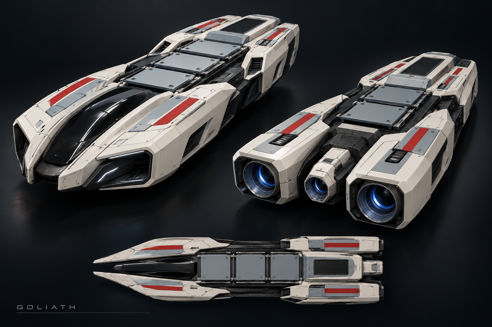
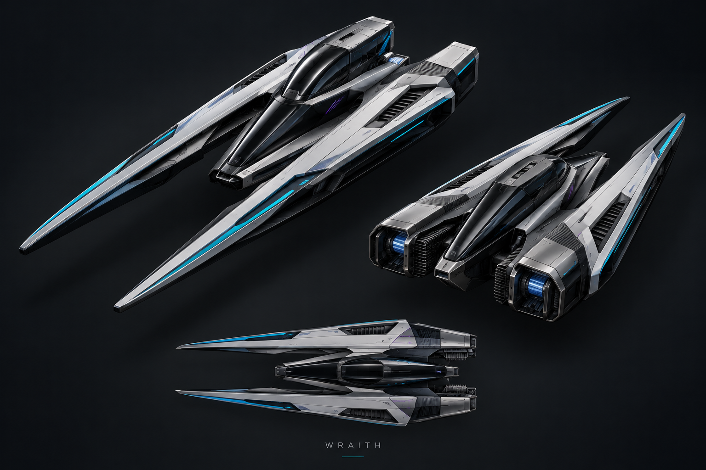
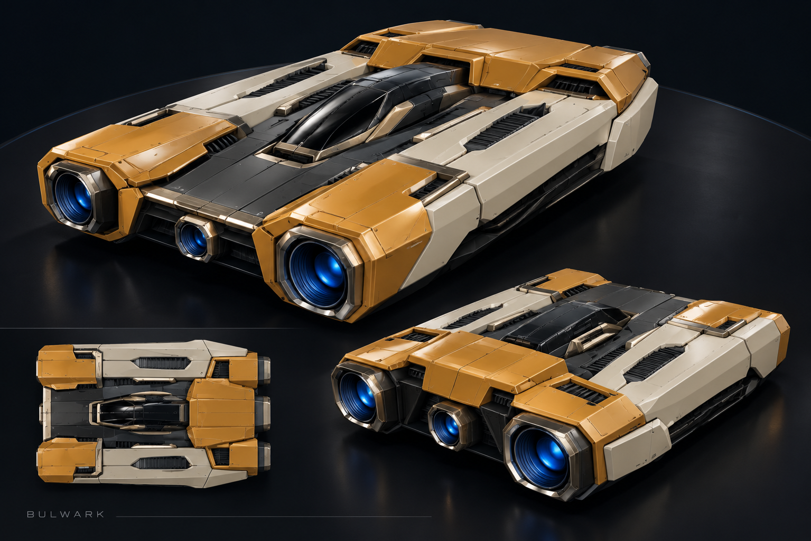

# Boss ship concept references

Generated with the built-in imagegen tool on 2026-10-28. These are modeling references, not runtime textures. They guide the formed hull surfaces, assembly hierarchy, livery and clean PBR finish; existing collision envelopes and exhaust anchors remain authoritative.

## Goliath

Final generation prompt:

Use case: stylized-concept. Asset type: final 3D modeling reference for VECTOR//NOVA antigravity racing boss GOLIATH.
Reimagine Image1's crude heavy courier into a beautifully manufactured AAA game vehicle. Image1 supplies ONLY overall heavy long connected courier mass and aft twin large engines plus smaller central engine. Image2 is approved player fleet STYLE/FINISH reference, not a shape to copy. Evolve the slab blockout freely into shaped, layered finished geometry while keeping low long heavy courier proportions 40m long,16m wide,6m high. No aircraft wings, tall fins, wheels, guns attached, space battleship turrets or fantasy floating parts. Remains an antigravity road racing vehicle.
Distinct design: broad tapered armored prow, protected low dark panoramic command glazing forward, connected cargo pressure spine, integrated massive rounded rectangular twin aft nacelles. Sculpted pearl ivory ceramic armor over exposed graphite composite load-bearing carriers, strong vermilion red identification inlays, pale cool service panels and machined titanium fittings. Sophisticated curved crown and shoulder transitions, believable seated panels of varied functional scale, recessed intake vanes, clean panel gaps and fasteners. Three deep pressure engines with thick seated cold cuffs, concentric machined rings, dark heat liners and recessed cool blue cores. Clean premium finish, no rust/dirt/noise. Bold large livery shapes and restrained tiny markings. Match the approved fleet's sculpted quality and glossy dark glass, broad coated reflections, not flat boxes.
Composition: single landscape industrial design concept sheet, same consistent ship shown as a large elevated FRONT three-quarter view on left and a large elevated REAR three-quarter view on right; small top plan beneath if room. Neutral dark studio background and soft broad key lights, all parts clearly readable, no environment/particles, no exhaust hiding engines, no dramatic bloom, crisp PBR rendering. Include tiny title GOLIATH only. This is a buildable design guide, not a screenshot edit.

## Wraith

Final generation prompt:

Use case: stylized-concept. Asset type: final 3D modeling reference for VECTOR//NOVA antigravity racing boss WRAITH. Reimagine Image1's primitive split-prong cutter into a genuinely finished AAA game vehicle. Image1 is only an overall slim fork silhouette/proportions guide, not final geometry; Image2 is approved fleet MATERIAL/FINISH reference, not shape to copy.
Wraith is a low eighteen-metre long, eight-metre wide, three-metre high interceptor, with two separated long narrow forward blade hulls flanking a narrow command spine, a swept low integrated cockpit and two recessed aft ion drives. Evolve large primitive slabs into precision compound formed fairings, variable airfoil-like thickness sections, layered blade roots transitioning into nacelles, open negative spaces and clearly load-bearing graphite carriers. Lean predatory non-aircraft antigravity racer: no wings, tall fins, wheels, external guns, battleship towers or detached decorative shapes.
Distinct palette/identity: glossy midnight graphite composite primary structure, cold silver ceramic blade skins with deep slate inserts, coherent bold cyan identification inlays and just a restrained violet secondary mark. Rich broad reflections on curved graphite surfaces, dark glossy framed command canopy, clean ceramic clearcoat, precision titanium engine cuffs and collars, true dark deep thermal chambers, small cool blue ion cores. Clean no dirt/rust/random noise; purposeful varied panel scale, real intake/vent depth, small fasteners only where structure calls. As polished as the reference player ship, never a set of bevelled boxes.
Composition: landscape concept sheet shows SAME consistent ship as a large elevated FRONT three-quarter on left and a large elevated REAR three-quarter on right, with small top plan beneath if room. Neutral dark studio, broad soft key/rim lights, crisp clear PBR surfaces, physically buildable. No environment, exhaust obscuring engine interiors, action blur, bloom or random emissive edges. Tiny title WRAITH only.

## Bulwark

Final generation prompt:

Use case: stylized-concept. Asset type: final 3D modeling reference for VECTOR//NOVA antigravity racing boss BULWARK. Transform Image1's extremely crude slab blockout into a spectacular polished AAA game vehicle. Image1 ONLY supplies short broad shield-barge proportions and triple aft-engine arrangement; freely sculpt its forms. Image2 is approved player fleet SURFACE QUALITY reference, not a ship shape to copy.
Bulwark is 20metres long,12metres wide,4metres high. A heavily armored low antigravity freight barge with a broad hammerhead shield prow, deep thick side sponsons, low seated central command citadel and three widely spaced recessed aft ion drives. It must look like a powerful road-going antigravity racing boss, not a tank, aircraft, spaceship battleship or building. No wheels, wings, tall fins, turrets, external weapons or detached pieces. Aggressively formed chamfered but subtly curved shield cheeks; stepped armor layered over deep structural graphite chassis; smoothly integrated cockpit and shoulder carriers; believable negative spaces, cooling trenches and segmented radiator banks. NOT a giant flat rectangle with tiny grooves.
Distinct identity: warm ochre/golden yellow shield armor and broad bold identification blocks over clean pale warm porcelain side armor, charcoal composite underbody, machined brass-tinted titanium collars; dark glazed command canopy. Larger quieter armor panels, broad compound surface reflections and restrained fasteners, well seated interlocking construction, precision clearcoat and subtle clean manufacturing textures. Three thick cold cuffs with dark deep narrowing pressure chambers, stepped liners and blue recessed cores; smaller middle drive, two larger outer drives. No rust/dirt/random wear or pointless tiny greebles. High quality matching approved player ship, all visible surfaces designed.
Composition: landscape industrial design concept sheet, same consistent vehicle shown as a large elevated FRONT three-quarter on left and elevated REAR three-quarter on right, plus small top plan below if room. Neutral dark studio and broad soft lights, crisp PBR rendering clearly showing geometry, no environment/exhaust/particles/blur/bloom. Tiny title BULWARK only.
