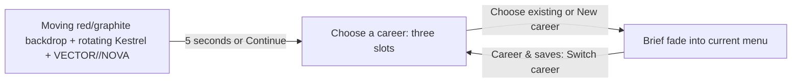

# Title and three-career entry flow

Scope for the next UI pass, before the next trailer recording. This is a proposal; the title and multiple career slots are not implemented yet. The current five-tab menu remains the destination after choosing a career.

## What the player sees

| Screen              | Layout and behavior                                                                                                                                                                                                                                                                                                                               |
| ------------------- | ------------------------------------------------------------------------------------------------------------------------------------------------------------------------------------------------------------------------------------------------------------------------------------------------------------------------------------------------- |
| **Title**           | The existing animated menu backdrop fills the screen immediately. The real Kestrel fades in, rotating at the existing gentle pace. Place the game's wordmark beside it on desktop, above it in portrait, with a slow, small opacity pulse. Keep a quiet Continue prompt; no stats, garage controls or feature overlays.                           |
| **Choose a career** | Keep the same moving backdrop. Show a clear heading and three equal cards across desktop; stack the cards in portrait and allow normal page scrolling in short landscape windows. Each occupied card shows its name, the real segmented reward bar, trophy count, current cup/event if present, and last played. Empty slots read **New career**. |
| **Enter menu**      | Selecting a slot gives a short 180–250ms fade into the existing Race page and its five tabs. Retain backdrop phase and music playback. Do not add an extra confirmation for selecting an existing slot or creating a fresh empty one.                                                                                                             |

Use default names **Career 1 / Career 2 / Career 3** initially; renaming can be a later addition. An existing card might read `Career 1 · 5/28 rewards · 1/4 cups · Frontier, race 2/3`; derive every value from that slot. Demo cards use the actual demo reward/cup totals. Do not seed fictional progress.

The title is immediately skippable by click/tap, Enter/Space or controller A. Focus the last-used occupied slot, falling back to Slot 1, but require a choice rather than silently loading it. Reduced motion uses a still background/ship and no wordmark pulse. Keep the profile picker usable if the ship is still loading or its preview fails.

The **0.7 seconds of black is a movie edit**, not a mandatory pause between the game's title and profile picker. The trailer opens on the real title for five seconds, then black, then Glasswake. The profile interaction can appear later if it earns readable screen time.

## Reuse and startup boundary

- Reuse one [menu backdrop](../src/frontend/menu-backdrop.js) across title, slots and menu.
- Reuse the [ship preview](../src/frontend/ship-preview.js) with a small presentation option to suppress its drag hint, interactive orbit input and canvas tab stop. Load only Kestrel for the title; defer fleet/race loading until a career is chosen. Showing Kestrel here does not unlock it or change Shrike as the starter.
- Add a startup coordinator before [createFrontend](../src/core/main.js) constructs profile/cup stores. Give the frontend an explicit disposal path so switching careers cancels pending loads, stops the retained session and removes old listeners/writers before another slot opens.
- Keep developer, inspection, test and capture entry URLs immediate and isolated. Their existing workflows must not become blocked behind the title/profile picker.
- Add **Switch career** to the top of Career & saves. Preserve the active slot's earned progress before returning to the picker; handle an unfinished race explicitly rather than letting its old session write into another slot.

## Three real saves

Use a small slot registry and a stable storage adapter for each slot. The existing profile, cup, trophy and save-transfer stores already accept storage injection; reuse their formats and validators.

- Scope career, equipment/loadouts, active cup, trophies, Time Trial records **and ghosts**, previous import backup, chosen ship and chosen circuit to the selected slot.
- Pass the same adapter through all store creation, record readers and runtime trial storage. Its `key()`/`length` must enumerate only that slot while exposing the existing logical key names. Set `isolated: true` so Time Trial's in-memory fallback cannot leak records between slots.
- Keep graphics, controller bindings, volume and music preferences shared initially. Retain the current demo/full application-data separation and cross-edition save-transfer behavior.
- Import/export and **Export previous backup** operate on the selected career. Reuse the current version-1 export format, validation, bounded import and rollback behavior; importing into one slot must never replace another slot's records.
- On first use, copy today's career into **Career 1**, including cups, trophies, records/ghosts, backup and ship/track choice. Validate the complete copy before marking migration complete. Retain the legacy data until migration is confirmed; make interrupted/quota-failed migration retryable. Unreadable saved progress must not appear as an empty slot.
- Keep `dev=1` playtest data separate from live slots and `dev=2` synthetic. No title/profile showcase should mutate a player's career.

## Build order and readiness

1. Agree the title/profile-card layout with a small click-through prototype using the existing art and renderer.
2. Implement slot storage, migration and isolation, then move frontend startup behind the picker. Exercise real progress before adding transition polish.
3. Add the skippable title and short transitions; preserve the current menu, settings and soundtrack pages after selection.
4. Verify legacy migration with actual ghosts/backups; slot-to-slot isolation; destination-only import/export/rollback; switching during loading/results; storage failure; demo/full boundaries; keyboard, controller, touch, portrait/landscape and reduced motion.
5. Re-record the trailer only after the UI and in-flight gameplay fixes are stable. Capture the real title, then refresh menus/gameplay and the edit plan using [the working script](../marketing/script.md). Keep RC1 unchanged.

Initial scope excludes cloud sync, arbitrary slot counts, slot deletion/reordering and additional intro sound generation. The existing Ionwake bed can carry the movie reveal without engine/boost noise.
