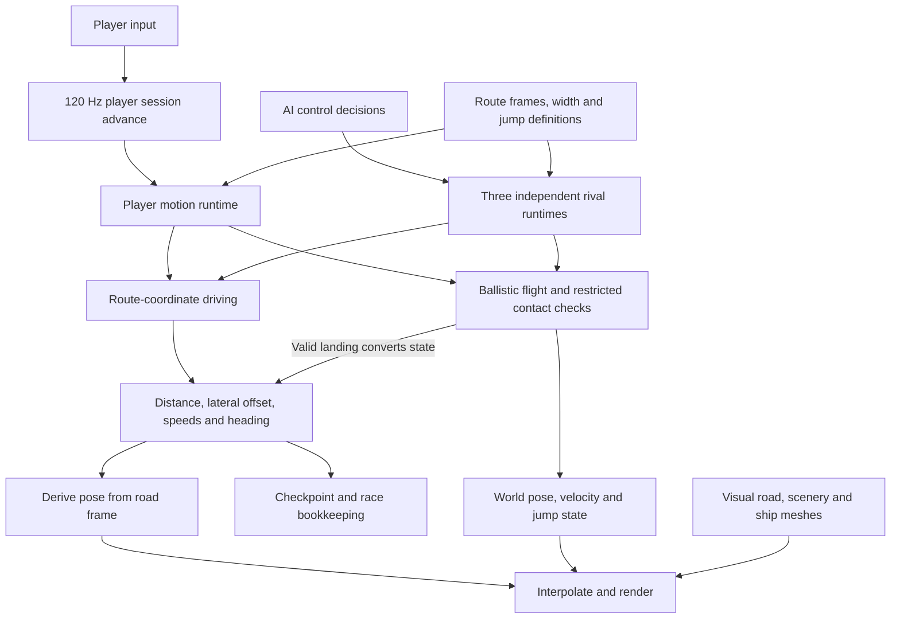
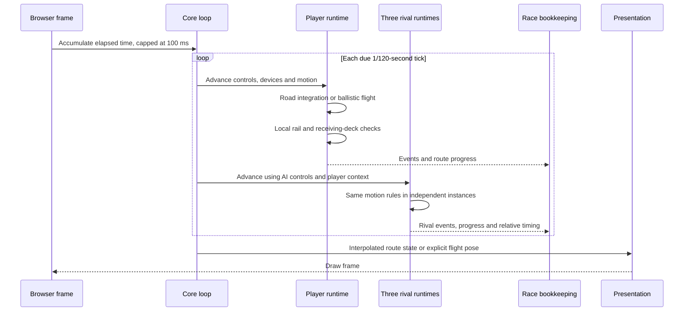
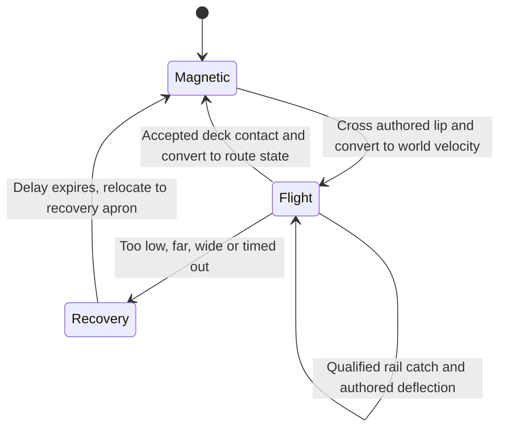

# Architecture before geometry collisions

Historical analysis saved on 2026-10-17. The reference revision is **`cb4edad7899cbdba7c826f90be863e3433e7a88e`**, the direct parent of `7fef16a5` ("add Rapier flight collisions and deck traction"). Sources below were read from that revision using `git show`, without changing the active checkout. Compare with [the current architecture and proposal](proposal.md).

## What “before collisions” means

There was already limited contact behavior: mathematical road-edge rebounds and purpose-built receiving-deck/rail checks during jumps. This reference predates the general geometry collision world and Rapier integration, not every form of collision detection.

Two boundaries matter:

| Revision   | Change                                                                                                                 |
| ---------- | ---------------------------------------------------------------------------------------------------------------------- |
| `cb4edad7` | Reference here: route-based driving, custom ballistic flight and restricted landing/rail checks; no Rapier dependency. |
| `7fef16a5` | Adds `collision-world.js`, `rapier-world.js`, shared hull helpers and geometry-based flight collisions.                |
| `c365854d` | Later expands the field to ten racers and introduces physical magnetic collisions.                                     |
| `91c61984` | Current analysis baseline after the road-contact redesign and accepted profiling optimizations.                        |

The old race field was **one player plus three rivals**, not the current one plus nine. This is an important comparison variable: the later changes increased both simulation complexity and the number of simulated vehicles.

## The central design

The game owned movement directly. While on the road, a ship was primarily a small collection of route coordinates: distance along the track, lateral offset, speed, lateral speed and heading. Its world position and orientation were derived from those values and the road frame.

“Hover” was a placement rule, not a suspension system. The ordinary pose was the road's sampled position plus lateral offset plus a fixed 0.72 m upward offset. Pitch and roll followed the road, with heading and a small steering lean layered on top. There was no rigid body whose height needed to be solved against a floor.

During a jump, the motion adapter temporarily owned a world-space position, velocity and orientation. A successful landing converted that state back into route coordinates. The state machine made this change of representation explicit.

## Components



The ground and air boxes are shared algorithms used by separate vehicle instances. They are not a shared physical world. There is no global contact solver coupling the ships.

The AI considers nearby racers when selecting a lane, but avoidance is steering logic. It does not create physical hull separation or exchange collision impulses. A rival having its own simulation and rendered ship did not mean it had ship-to-ship rigid-body collisions.

## Logic flow and clocks



The browser already had the 120 Hz accumulator and 100 ms elapsed-time clamp. The player advanced first through `advanceSession`; core then called `racers.advance` for the same duration. Rival controls were selected from a nearby-state snapshot before their individual advances.

There were no additional 240/480 Hz Rapier world steps, rigid-body solver iterations or native CCD passes. Standalone calls to the motion routines subdivided oversized durations to the same bounded 120 Hz step; this did not introduce another high-frequency engine loop during ordinary fixed-tick play.

Sequential player/rival advancement was adequate for largely independent motion. Once ships physically affect one another, staging all actors before one shared world step becomes much more important.

## Grounded movement

`src/physics/index.js` integrated a compact state:

1. Read the road frame at the current route distance.
2. Apply handling values for throttle, boost, braking, drag and steering.
3. Project gravity along and across the banked road. The normal component is implicitly canceled by magnetic adhesion.
4. Update forward distance, lateral speed, lateral offset and heading. Steering assistance remains 0.3.
5. Check the swept lateral extent against mathematical road bounds.
6. Apply an authored rebound and emit an impact event when a bound is crossed.

The rail check accounted for the yaw-dependent width of a shared rectangular footprint and an interior lateral-motion extremum. It was more careful than checking the final center point, but it was still a small scalar calculation against a road interval. It did not sweep every model part against visible rail triangles.

On a ground rail hit, code clamped the lateral coordinate to the allowed boundary, reversed a fraction of lateral velocity, reduced forward speed and heading, and applied reserve loss unless shielded. A cooldown limited repeated impact penalties. Optional split-road bounds could describe an inner divider.

This produced direct and predictable arcade behavior. It could not naturally represent a wing sliding along an irregular obstacle, a ship lying across a barrier, or two racers exchanging angular momentum.

## Jump and landing state machine



**Takeoff:** the adapter first estimated the grounded tick. If it crossed a launch lip, it restored the previous state, integrated only to the lip, initialized world velocity from the route frame plus any level impulse, and spent the remainder of the tick in flight. This fractional transition was possible because the vehicle did not share a coupled physical solve with other actors.

**Flight:** the adapter directly integrated position and velocity under gravity and air steering, plus any level-specific force. Orientation followed ballistic velocity with a smoothed steering lean. Race distance stayed at the departure address until a jump-transfer event awarded or rejected progress.

**Receiving checks:** the current jump's finite landing interval was cached as route-frame segments spaced at up to 4 m. Swept rail and lower-hull checks rejected distant segments cheaply, refined candidate contact frames, and required acceptable heading, pitch/roll and overlap. Curved-deck fallback could project onto the sampled route surface and bisect a crossing. This was nontrivial local geometry work, but it was restricted to the declared receiver rather than arbitrary scene triangles.

The implementation compared deck and rail contact time so a later rail hit did not erase an earlier valid landing. A qualified rail catch moved the craft inward and imposed an authored reflected velocity. These checks were also landing eligibility rules: they were not a general solver for every orientation and solid surface.

**Landing:** the adapter explicitly assigned route distance, lateral offset and heading, projected world velocity into forward/lateral speeds, and resumed magnetic motion. A short orientation/height settle preserved visual continuity; there was no physical support joint to attach.

**Miss and recovery:** geometric limits or a timeout started a recovery delay. The craft continued a simple falling trajectory, then was placed at the authored recovery apron. The game did not resolve arbitrary scenery collisions during that recovery.

## Ownership and tradeoffs

| Concern                            | Historical owner                 | Consequence                                                       |
| ---------------------------------- | -------------------------------- | ----------------------------------------------------------------- |
| Supported position                 | Route-coordinate integrator      | Stable attachment without solving suspension.                     |
| Hover height and road attitude     | Pose construction                | Fixed offset and direct road following.                           |
| Airborne pose                      | Ballistic flight adapter         | Predictable flight, limited physical response.                    |
| Ground rail response               | Coordinate-bound rule            | Cheap, forgiving, but detached from detailed visible geometry.    |
| Landing and receiver rail response | Jump-specific analytic checks    | Bounded scope, strong assumptions about where contact can happen. |
| Racer interaction                  | AI lane choices                  | Avoidance without physical nonpenetration or impact transfer.     |
| Race progress                      | Route state plus transfer events | Jump outcomes explicitly control checkpoint credit.               |
| Rendering                          | Derived/interpolated state       | Presentation does not solve physics.                              |

There was one movement authority in each state, with an explicit conversion at transitions. This is an architectural strength worth preserving in either a dynamic-body design or an arcade controller.

The simplification also had clear limitations: visual architecture was not generally solid, unusual collision angles were outside the landing model, off-road behavior was heavily constrained, and nearby ships did not physically resolve against one another. It was solving a smaller problem.

## What this tells us about the FPS investigation

The historical architecture explains why detailed scenery could exist without equivalent physics cost: rendered polygons were not automatically collision inputs. Supported travel involved a few route samples and scalar calculations per vehicle. Flight work was concentrated around the known receiving interval.

That is an architectural cost comparison, **not a measured historical FPS result**. This analysis did not run a historical benchmark. Ship count, art, course geometry and rendering have also changed, so comparing old and current playthroughs alone cannot isolate collision overhead.

A useful controlled comparison would hold route, art, camera, controls and racer count constant, then vary movement/collision policy. It would distinguish:

- The four-to-ten racer increase.
- Ground support and contact work.
- Airborne collision detail and CCD.
- Rendering and GPU cost around the same landmarks.

The design choice is therefore concrete: retain the current dynamic-body model with a much smaller collision budget, or deliberately return to game-owned movement and add bounded collision queries plus explicit response rules. The historical implementation demonstrates how stable road attachment and cheap travel can work. It does not provide a complete replacement for the physical interactions added since then.

## Historical source map

These paths refer to `cb4edad7`; current files at the same paths may differ or have moved.

| Historical path under `games/vector-nova/` | What was inspected                                                                                    |
| ------------------------------------------ | ----------------------------------------------------------------------------------------------------- |
| `src/core/main.js`                         | Fixed-step accumulator, player-then-rival ordering, route-derived world pose.                         |
| `src/core/session-runtime.js`              | Direct runtime advance, event/race processing and replay state.                                       |
| `src/physics/index.js`                     | Route-coordinate integration, parking, magnetic assumptions and analytic rail bounds.                 |
| `src/physics/flight.js`                    | Ground/flight/recovery modes, receiving-segment cache, sweeps, fractional takeoff and state transfer. |
| `src/race/racers.js`                       | Three-rival roster, independent runtimes and nearby-racer lane decisions.                             |
| `package.json`                             | Three.js dependency; no Rapier dependency.                                                            |

For example, from the repository root:

```sh
git show cb4edad7:games/vector-nova/src/physics/flight.js
git show cb4edad7:games/vector-nova/src/core/main.js
git show --stat 7fef16a5 -- games/vector-nova
git show --stat c365854d -- games/vector-nova
```
