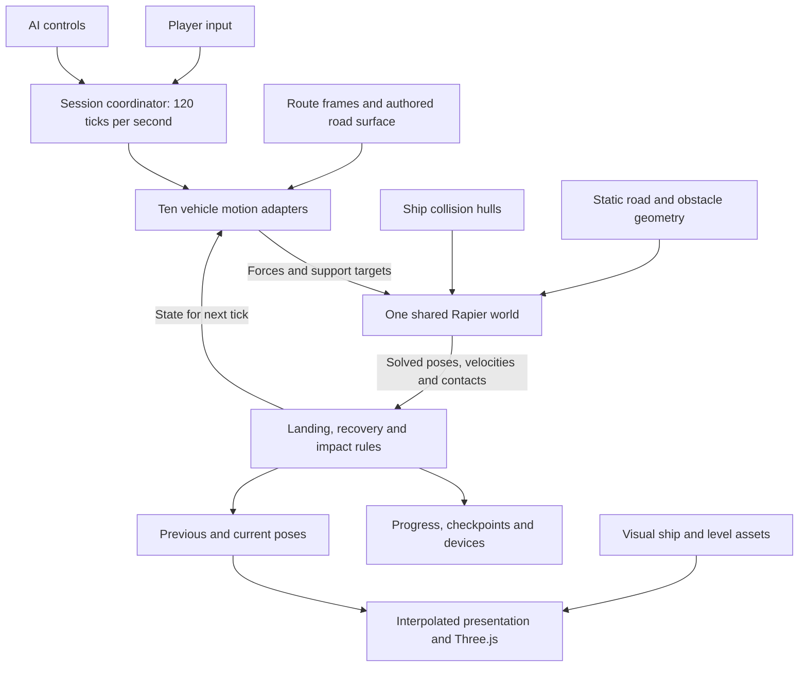
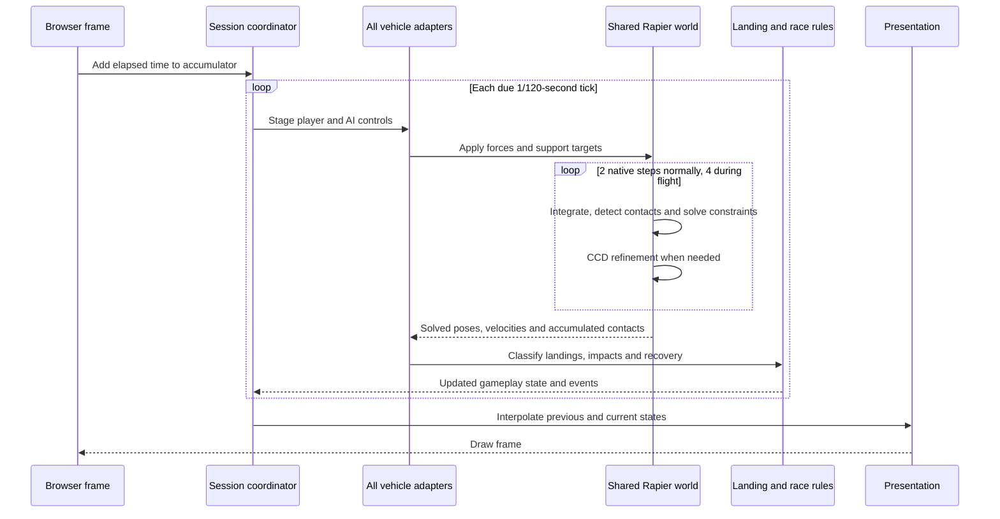
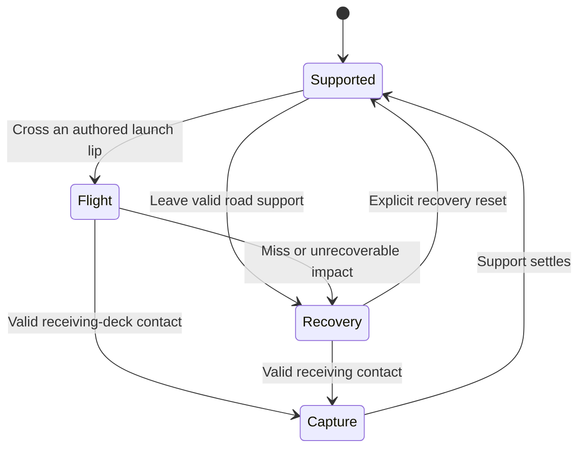

# Physics architecture and proposal

Analysis saved on 2026-10-17 against `91c61984` on `codex/zephyr-art-rework`. This records the rigid-body baseline and the proposals discussed before the query-controller prototype. For the current worktree implementation, see [architecture](../../ARCHITECTURE.md). See [the architecture before geometry collisions](before-collisions.md) for the historical comparison.

## The central architectural question

Who owns the ship's position and orientation, and what is a collision allowed to do to them?

The current production game gives Rapier ownership of physical movement. Custom handling supplies forces and road-support constraints; gameplay code interprets the solved result to decide whether the ship is driving, flying, landing or recovering. This is a valid architecture. The concern is the cost and coordination of those responsibilities at our current precision and update rates.

A **pose** is position plus orientation. A **constraint** restricts movement, such as holding a ship above the road while allowing it to move forward and sideways. **CCD**, continuous collision detection, checks motion between simulation samples so a fast ship does not pass through a thin obstacle.

## Components

The three geometric representations serve different purposes:

| Representation              | Job                                                                         |
| --------------------------- | --------------------------------------------------------------------------- |
| Visual meshes               | Draw the ships and environment.                                             |
| Route and road-surface data | Describe local forward/up/side directions, race progress and valid support. |
| Collision geometry          | Tell the physics engine which physical shapes may touch.                    |

They need to agree about the road and ship, but need not have identical detail. The recent road-contact work makes support use the authored running skin and filters contact with the skin it already owns, including aligned backing immediately underneath. That removed a substantial source of redundant contact work on Umbra Wide.

The production path does **not** run the legacy custom hull-sweep response and Rapier response simultaneously. The custom path remains for callers without dynamics; the CPU geometry also supplies static geometry and landing information.

## Logic flow and clocks

There are three distinct rates:

- **Rendering:** variable, ideally 60 frames per second or better.
- **Controls/gameplay:** 120 fixed ticks per second.
- **Native physics:** 240 steps per second for supported travel, 480 when any actor is airborne or fast opposing contacts require it. CCD may add refinement within that work; its configured maximum of six is a ceiling, not six mandatory extra steps every time.

All actors stage their inputs before the shared world advances. They participate in the same physical time interval, which is important for consistent ship-to-ship response.

Physics runs synchronously before drawing. The browser elapsed-time clamp allows approximately 12 gameplay ticks after a 100 ms delay. At the flight cadence, that can mean 48 native world advances before the next draw, with CCD work inside them. An expensive frame can therefore cause catch-up work that makes the next frame expensive too. The clamp bounds the backlog but does not guarantee a render-time budget.

## Hover, flight and landing

`Capture` names a conceptual phase, not a separate public runtime mode. The implementation uses magnetic mode with landing-settle and support-compliance state.

**Supported travel:** the ship remains a dynamic Rapier body. A joint to a fixed support anchor holds normal position, pitch and roll relative to the road; forward/sideways movement and yaw remain available. Handling supplies propulsion, grip and steering. The support target follows the sampled road and is interpolated across native substeps. Nearby racer contact temporarily allows bounded pitch/roll response; normal support remains controlled.

**Flight:** support is released at a solved gameplay-tick boundary. Gravity, propulsion and air-control forces act on the dynamic body. Rapier owns collisions and angular response. Flight also receives a larger solver-iteration budget, and one airborne ship raises the native cadence of the shared world.

**Landing:** contact records accumulated during the tick are classified using the final solved body pose and landing rules. The game checks the receiving surface, orientation and sufficient hull support before adopting magnetic support again. Normal compliance allows capture to settle. The native path retains the solved pose and momentum; ordinary landing does not teleport the ship back onto the route. Explicit recovery is a separate relocation operation.

The handoff spans a boundary: the physics world solves contacts, gameplay recognizes a valid landing, and the next staged step applies support. This is why changing timing or solver cadence can alter touchdown behavior even if the visible trajectory appears similar.

## What the measurements establish

At the restored `91c61984` baseline, the ten-ship CPU jump probes averaged roughly **4.9 ms of physics per 120 Hz tick on Zephyr** and **5.1 ms on Umbra Wide**. At 60 FPS, two such ticks consume roughly 10 ms of the 16.7 ms frame budget before other simulation, rendering submission and GPU work. These are CPU probe measurements, not measured foreground FPS or a complete GPU profile.

The remaining cost is concentrated in native collision work, particularly CCD. Joint solving was much smaller in the counters inspected. Some counters overlap, so they must not be added as independent costs.

The field has many separate convex collider pieces: the measured Kestrel-plus-nine-rival roster uses 74. These are derived from the actual ship models with a tight 10 mm outer-error requirement and preserved openings. Fast moving parts near dense static triangles produce substantially more work than a single coarse vehicle proxy.

Four subsequent experiments were rejected and fully rolled back: different hull reduction, fewer CCD subdivisions, adaptive native cadence, and adaptive CCD refinement. They either regressed another circuit, broke contact correctness, or produced negligible improvement. The baseline remains `91c61984`; none of those experiments is an accepted optimization.

## What to preserve and what to reconsider

The shared simulation clock, separate presentation, replay identity, and common player/AI motion rules are useful foundations. The architecture does not need to be discarded wholesale.

The weak points are:

1. **Collision detail and frequency consume the frame budget.** Model fidelity, separate collider count, 480 Hz flight updates and repeated CCD work compound one another.
2. **Support and contact response require careful coordination.** Filtering the already-owned road skin is necessary, and landing changes which system provides support. The contract needs to make those transitions explicit.
3. **Gameplay behavior is partly an emergent solver outcome.** Detailed wing tips can catch rails even when the intended experience is a forgiving slide. More physically accurate geometry does not automatically produce better racing behavior.
4. **One local event can increase global work.** Any airborne racer changes the native cadence for the whole shared world.
5. **Catch-up has a time bound, not a CPU budget.** The render thread must finish accumulated simulation work before presenting another frame.

Replacing the support joint with spring forces is an experiment, not a demonstrated FPS fix. Forces may simplify ownership or permit a different cadence, but replacing a comparatively small joint cost while preserving the same expensive CCD workload may accomplish little.

## Two coherent designs

| Choice             | Dynamic vehicle                                         | Arcade movement controller                                       |
| ------------------ | ------------------------------------------------------- | ---------------------------------------------------------------- |
| Pose authority     | Rapier integrates and resolves the body.                | Game code chooses movement and resolves allowed displacement.    |
| Hover              | Forces or constraints establish road support.           | Road-relative controller establishes attachment directly.        |
| Collision response | Engine impulses, shaped by contact rules and geometry.  | Sweeps/queries followed by authored slide, bump and crash rules. |
| Ship interaction   | Shared rigid-body contacts.                             | Explicit separation and momentum rules between controllers.      |
| Main risk          | Excessive collision work or unwanted physical behavior. | Rebuilding a difficult movement/contact solver in game code.     |

Switching a body to kinematic does not implement an arcade controller. Kinematic bodies do not automatically yield to contacts like dynamic bodies; the game must prevent penetration and decide how movement changes. Likewise, a worker could isolate rendering from some CPU stalls but would not remove the physics workload or settle ownership questions.

## Proposed next step

First prototype a cleaner **dynamic vehicle contract**, using the existing shared world:

- Rapier owns physical pose and velocity.
- One support controller owns road attachment, release and capture.
- The road service answers which finite surface can support the ship and supplies its frame.
- Collision proxies and response rules implement the agreed racing behavior.
- Race progress, camera and rendering consume solved state rather than correcting it.

The experiment must reduce actual collision work, not merely rearrange JavaScript. Compare a budgeted collision representation and support strategy at a consistent world cadence, with 120 Hz as a target to investigate and 240 Hz as a possible intermediate step. Neither rate is an established safe replacement yet.

Keep experiments separate and reversible. A useful acceptance target is a substantial reduction, such as at least 40% physics CPU in the affected ten-racer jump/bend probes, without worse tail latency, missed contacts, rail traps, broken landings or replay regressions. Then verify the affected scenes in the foreground browser; CPU probe gains alone do not establish the FPS improvement.

Before changing fidelity, decide what we want a rail scrape and a crowded landing to feel like. Forgiving rail slides, stable magnetic adhesion, detailed wing-tip contact and unrestricted collision spin can demand conflicting rules. The desired game behavior should determine the collision contract.

## Code and references

Current code entry points:

- [Frame accumulator and rendering](../../src/core/game.js)
- [Session staging and shared advancement](../../src/core/session-runtime.js)
- [Rapier bodies, colliders, support and native stepping](../../src/physics/rapier-world.js)
- [Magnetic handling and support queries](../../src/physics/magnetic-body.js)
- [Flight and landing transitions](../../src/physics/flight.js)
- [CPU collision geometry and legacy sweeps](../../src/physics/collision-world.js)
- [Generated physical ship hulls](../../src/ships/collision-hulls.js)
- [Maintained CPU jump probe](../../tools/profile-jump-physics.mjs)

The query/support/force/body separation has precedent in [PhysX vehicle architecture](https://nvidia-omniverse.github.io/PhysX/physx/5.6.1/docs/Vehicles.html). Rapier documents the ownership differences between [dynamic and kinematic bodies](https://rapier.rs/docs/user_guides/javascript/rigid_bodies/#rigid-body-type) and the work performed by [continuous collision detection](https://rapier.rs/docs/user_guides/javascript/rigid_body_ccd/). These references describe design mechanisms; they do not prove a particular redesign will meet this game's performance target.
